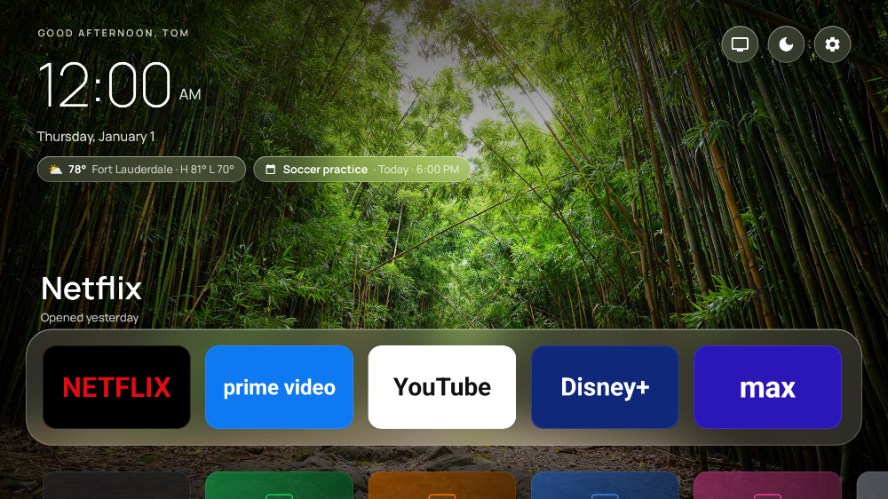

# AttuneTV

A clean, ad-free home screen for Fire TV. It works like other community launcher
projects: your apps sit in a simple grid, with no sponsored rows, autoplaying
trailers, or "recommended for you."

Built for **Fire OS 8.1.6.4** on an Insignia NS65-UQFL26 (Fire TV
Edition, Android 11 base). It should work on any Fire OS 6–8 device.




*Rendered from the real layouts at Fire TV's 1080p canvas with Paparazzi (`./gradlew recordPaparazziDebug`).
App art is placeholder; on the TV each app's own banner appears.*

## What you get

**Home screen**
- **Daily photo background** (Bing image of the day, no key), with **real frosted glass** that works on
  Fire OS 8 / Android 11. The wallpaper is pre-blurred once on the CPU, and each glass surface draws the
  slice behind it. Other options: an app-color glow that follows focus, or a plain theme color.
- **Big, quiet type**: a greeting with your name, a thin clock, the date, and glass chips for weather and your next event.
- **Glass dock** of favorites as 16:9 tiles. The focused tile lifts with a springy zoom, a white ring and a glow
  in the app's own color. The selected app's name and when you last opened it show above the dock.
- **All apps** sits below the dock. Press **Down** and it slides up over a blurred background; press **Up** or Back to return.
- Apps without a TV banner get a tile tinted with their icon's color.
- **☰ Menu (or long-press OK) on any tile** opens a smoked-glass menu: Open, Pin/Unpin, Move, Hide, App info.
  The Inputs list and Settings confirmations use the same glass menu. Move mode: arrows, then OK.
- Round glass buttons: **Inputs** (HDMI/antenna), **Ambient**, **Settings**.

**Widgets**
- **Weather** (Open-Meteo, no account or API key): current temperature, conditions, today's high/low, rain chance.
  Location can be a ZIP code, "City, State", or auto-detected from your connection.
- **Calendar "Up next"**: reads any iCal feed (Google, iCloud, Outlook) and supports repeating events.
- **Ambient mode (photo screensaver)**: after a period of no activity (default 10 min) or from the moon button, the
  last 8 daily photos play with a slow zoom and pan, under a large clock with weather, forecast and your agenda.
  → skips to the next photo; any other button exits.

**Quick actions**
- **Inputs**: switch to HDMI or antenna inputs, or jump to Amazon's Live TV.
- **Set up from your phone**: Settings shows a QR code. Scan it on the same Wi-Fi to edit location, calendars,
  favorites, hidden apps, theme, and more from your phone, with no typing on the remote.
  The page is protected by a random PIN and only works while that screen is open on the TV.

**System**
- Home button redirect (see below), opens on boot, 12/24-hour clock, five dark themes.

## Why there's an accessibility service

Fire OS doesn't let you choose a default home app, and on Fire OS 8, disabling Amazon's
launcher over ADB breaks Settings and profiles. Projects like Home on Fire and
LauncherHijack work around this instead. AttuneTV does the same:

`HomeButtonService` is an accessibility service that listens **only** for window changes
from `com.amazon.tv.launcher`. When Amazon's home screen comes up, the service brings
AttuneTV back on top. It can't read screen content (`canRetrieveWindowContent=false`),
and it ignores every other app.

You'll see Amazon's home screen for a split second before AttuneTV appears. That's
expected with this approach.

## Install

### 1. Get the APK

- **CI:** each push builds `AttuneTV-apk` under **Actions → Build APK → Artifacts**.
- **Locally:** `./gradlew assembleRelease` → `app/build/outputs/apk/release/app-release.apk`

### 2. Enable ADB on the TV

**Settings → Device & Software → About** ("My Fire TV" on sticks). Highlight the device name and press
OK 7 times to unlock Developer Options. Then go to **Device & Software → Developer Options** and turn on
**ADB Debugging**. Find the TV's IP under **About → Network**. The first `adb connect` asks you to approve the
computer on the TV.

### 3. Install and turn on the Home button service

```bash
adb connect <TV_IP>:5555          # accept the prompt on the TV
adb install -r app-release.apk

# Turn on the Home-button service (Fire OS 8 hides most accessibility toggles in the UI)
adb shell settings put secure enabled_accessibility_services \
  com.attunetv.launcher/com.attunetv.launcher.HomeButtonService
adb shell settings put secure accessibility_enabled 1
```

> If you already use another accessibility service, append to the existing list
> instead of replacing it:
> `adb shell settings get secure enabled_accessibility_services`, then set the value to
> `existing:com.attunetv.launcher/com.attunetv.launcher.HomeButtonService`.

Press Home and AttuneTV should come up. Without ADB, you can still open AttuneTV from
**Your Apps**. It just won't take over the Home button.

### Undo

```bash
adb shell settings put secure enabled_accessibility_services ""
adb uninstall com.attunetv.launcher
```

Or flip **Settings → Redirect Home button** off inside AttuneTV.

## Notes and known limits

- **Amazon updates can turn the accessibility service off.** If Home starts going to
  Amazon again, run the `settings put` command again. AttuneTV shows a "not set up" banner when the service is off.
- **The profile picker passes through.** Amazon screens whose class names contain
  `Dialog`, `Toast`, or `Profile` are not redirected (see `PASSTHROUGH_CLASS_HINTS` in
  `HomeButtonService.kt`). Settings shows the last Amazon screen class it saw, which makes it easy to add more.
- **Live TV / antenna input** on Insignia TVs lives in Amazon's UI. Use
  "Open Amazon home", or pin your input app if one shows up in the grid.
- **The release build is signed with the debug key** so the CI artifact installs on your
  own TVs. Set up a real keystore before you share it more widely.

## Project layout

```
app/src/main/java/com/attunetv/launcher/
  HomeActivity.kt       home screen: favorites row, app grid, menus, move mode
  SettingsActivity.kt   toggles, theme, shortcuts, reset
  HomeButtonService.kt  Home-button redirect (accessibility service)
  AppRepository.kt      app discovery (leanback first, then phone launchers)
  AppAdapter.kt         tile rendering and focus animation
  Wallpaper.kt          daily photo + CPU box blur
  GlassDrawable.kt      frosted glass for Android 11 (no RenderEffect)
  Colors.kt             dominant artwork color for tiles and glow
  Widgets.kt            weather and calendar state, caching, refresh
  Weather.kt            Open-Meteo + ZIP/city/IP location lookup
  Ics.kt                iCal parser with recurrence expansion
  AmbientActivity.kt    full-screen clock / weather / agenda
  PhoneSetupActivity.kt QR code screen, plus SetupServer.kt (LAN web page)
  Inputs.kt             HDMI / tuner inputs
  BootReceiver.kt       open on boot
  Prefs.kt / Themes.kt  persistence and backgrounds
```

## Calendar setup

Open **Settings → Set up from your phone** and paste one or more iCal links:

- **Google:** calendar.google.com → ⚙ Settings → choose the calendar → *Integrate calendar* →
  **Secret address in iCal format**.
- **iCloud:** Calendar → ⓘ next to the calendar → *Public Calendar* → copy the link.
- **Outlook:** Settings → Calendar → Shared calendars → *Publish a calendar* → ICS link.

Treat these links like passwords. They're stored only on the TV.

## Tests

`./gradlew testDebugUnitTest` covers the iCal parser: time zones, all-day events, line folding, weekly/monthly
repeat rules, EXDATE, moved instances, COUNT/UNTIL, and cancellations.

## Ideas for next

TMDB "trending" row, "continue watching" deep links, photo screensaver (Google Photos album),
per-profile layouts, folders.
