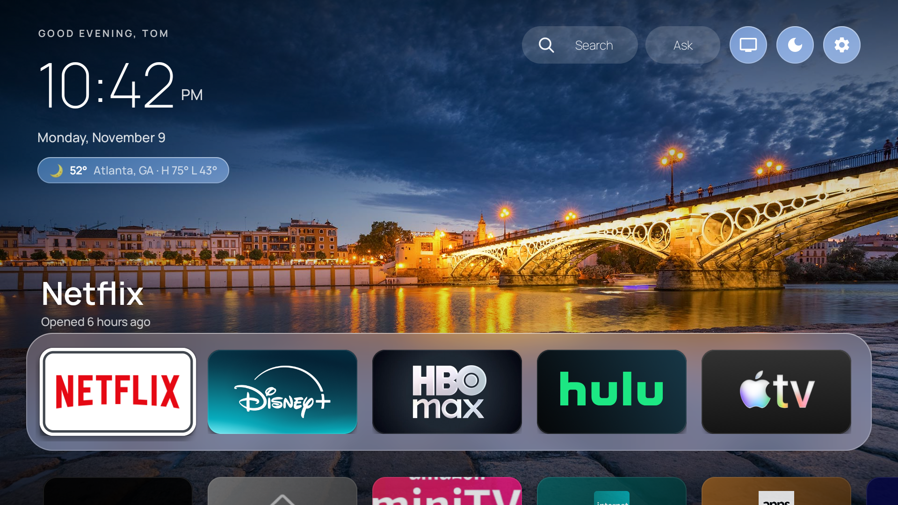
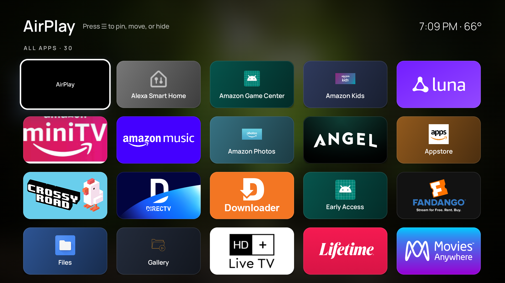
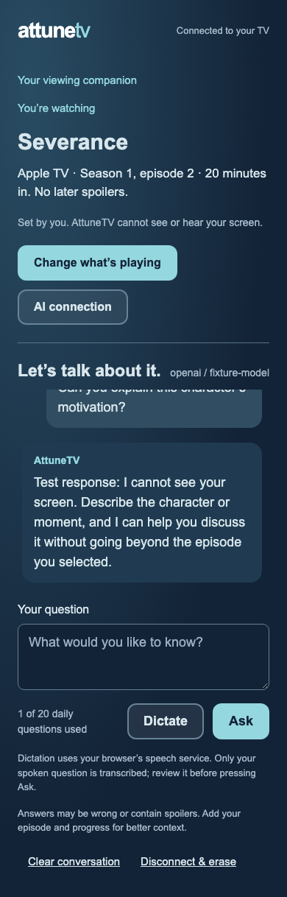

<div align="center">

# AttuneTV

### A calmer home. A conversation about what’s on.

A cinematic, ad-free home screen for Fire TV.<br>An optional AI viewing companion that brings your TV and phone into the same conversation.

[](https://github.com/thellis954/attunetv/actions/workflows/build.yml) [](https://github.com/thellis954/attunetv/actions/workflows/samsung.yml) [](https://github.com/thellis954/attunetv/releases/latest) 

**[Install on Fire TV](docs/install.md)** · **[Try the AI companion](https://attunetv-samsung.vercel.app/tv)** · **[Build with us](CONTRIBUTING.md)**



*Real Insignia capture · 0.5.0 development build · Streaming apps are installed separately.*

</div>

**Settle in. Find your show. Follow your curiosity.** AttuneTV starts with a home screen you control: your apps, your order, a daily photograph and room to breathe. Its companion preview adds a place to ask about the story—with shared viewing context and conversation history on TV and phone.

**Free to download. No always-on computer. Chat is optional; provider API usage is billed separately.**

> **Choose the right preview:** the public Fire TV download is **0.4.2**. The shared API-key chat shown below is in **0.5.0 development source** and the **hosted companion preview**, not that older APK. Samsung installation and live AI/playback verification are still in progress. [What works today ↓](#what-works-today)

## A home screen worth coming home to

Daily photography, frosted glass and clear remote focus give your apps a home of their own. Pin the ones you love. Hide the ones you never open. Press Down to see everything.

<table>
<tr>
<td width="50%"><a href="docs/images/apps-fire-tv.png"></a><br><strong>Your apps, within reach.</strong><br>One press down from the dock.</td>
<td width="50%"><a href="docs/images/menu-fire-tv.png"></a><br><strong>Make it yours from the couch.</strong><br>Pin, move and hide with the remote.</td>
</tr>
</table>

*Actual Insignia screenshots from 0.3.3. Earlier artwork and styling are visible. [Screenshot versions and provenance](docs/images/README.md).*

| Make the TV yours | How AttuneTV helps |
| --- | --- |
| **Find an app or a film** | Search installed apps locally, or jump to Amazon’s movie and show search. |
| **Set the mood** | Daily photo backgrounds, dark themes, an ambient photo mode and a personal greeting. |
| **See the useful things** | A large clock, optional weather and your next calendar event. |
| **Skip remote typing** | Scan a QR code to personalize the launcher from your phone on the same Wi-Fi. |
| **Keep your existing setup** | No root or Amazon-package removal. Your streaming subscriptions and apps stay in place. |

## Meet Ask with AttuneTV

**Keep the story on the big screen. Take the conversation with you.**

The companion preview gives TV and phone one shared conversation. Supply the show, episode and where you are; describe the moment you want to explore. Choose **OpenAI, Claude, Grok or Kimi** through guided API-key setup.

Questions to try once connected:

- “We’re halfway through episode two. Can you explain the relationship between these characters?”
- “I’m watching a film set in 1920s Chicago. What historical context would help?”
- “What should I pay attention to in this director’s use of color?”


*Browser test capture of the actual companion UI. The displayed answer is a test fixture, not a live model response or a Samsung-device capture.*

### Pair once. Keep talking.

<p align="center"><a href="docs/images/companion-phone.png"></a></p>

1. **Scan and approve.** Open **Pair phone**, scan the QR code and approve the matching number on the TV. To explore today, open the hosted preview on a computer and pair your phone.
2. **Connect the AI you choose.** The phone guide links to your provider’s billing and API-key pages, checks access, and lets you select a model and daily question limit. Enter your key privately on the phone.
3. **Set what’s playing.** Add a title, episode and progress. Ask on either screen. The phone conversation can continue after the TV companion closes, so you can return to your streaming app.
4. **Type—or dictate where supported.** Compatible phone browsers offer Dictate; review the words before sending. Your phone keyboard’s microphone is another option. TV remote voice support varies.


*Phone browser test capture; its answer and speech recognition use test fixtures. No real API key appears in these screenshots.*

**Your context, your choice.** AttuneTV does not capture the movie, listen to its soundtrack or read its subtitles. It uses the question and viewing context you provide; any automatic playback metadata depends on the app and device. Episode/progress instructions help limit spoilers, but accuracy and spoiler avoidance are not guaranteed.

**[Open the hosted companion preview →](https://attunetv-samsung.vercel.app/tv)**

## Why this combination?

A quiet launcher makes choosing something easier. A viewing companion gives curiosity somewhere to go after you press Play. AttuneTV brings them together around three choices:

- **Your screen:** personal Home, visible search and remote-first navigation.
- **Your AI:** a choice of provider and model, with setup guidance and explicit API costs.
- **Your place to chat:** a shared TV-and-phone conversation, including a phone path when the TV platform cannot show an overlay.

Custom launchers such as [Projectivy](https://github.com/spocky/miproja1) and [Clean Your TV](https://github.com/Gathin23/cleanyourtv) already make a strong case for a better home screen. [Gemini on Google TV](https://support.google.com/googletv/answer/16522213?hl=en) and [Prime Video’s X-Ray](https://www.aboutamazon.com/news/entertainment/what-is-x-ray-on-prime-video) show the value of questions and context around entertainment. AttuneTV’s direction is **personal Home + provider choice + a shared viewing conversation**. [Read the positioning and tradeoffs](docs/positioning.md).

## What works today

| Experience | Status and next step |
| --- | --- |
| **Fire TV launcher** | Tested on Insignia NS65-UQFL26 / Fire OS 8.1.6.4. Public APK: 0.4.2; current source: 0.5.0 preview. Other models need testing. **[Install guide](docs/install.md) · [Public APK](https://github.com/thellis954/attunetv/releases/latest/download/AttuneTV.apk)** |
| **Shared TV + phone chat** | Hosted pairing, setup links and context sync verified. Conversation flows have automated fixture coverage; real provider responses still need end-to-end validation. **[Hosted preview](https://attunetv-samsung.vercel.app/tv) · [Architecture](docs/standalone-chat.md)** |
| **Chat over Fire TV streaming apps** | Under development. **Hidden in normal builds** until each integration passes real playback, focus and dismissal checks. **[Verification checklist](docs/standalone-chat.md#verification)** |
| **Samsung Tizen companion** | Web preview built; Samsung signing, installation and hardware verification pending. Full-screen TV chat plus phone chat during playback; **no overlay over built-in streaming apps and no Smart Hub replacement**. **[Samsung setup](samsung/README.md)** |

Prime Video, Netflix, Apple TV, Disney+, Hulu, HBO Max, Peacock and Paramount+ are **Fire TV integration targets**, not a confirmed overlay support list. Launching an installed streaming app from Home is separate from supporting chat inside its player.

## Get it on your Fire TV

**No coding or Android Studio required.** Bring an Android-based Fire TV, its remote, and a Mac, Windows or Linux computer for installation.

1. **[Download the public APK](https://github.com/thellis954/attunetv/releases/latest/download/AttuneTV.apk).** No GitHub account required. [Release notes and checksums](https://github.com/thellis954/attunetv/releases/latest).
2. **Connect on the same home network.** Enable ADB debugging and approve the connection with the TV remote.
3. **Install, make it Home, personalize.** Follow the guide’s copy-and-paste commands, expected results and undo instructions. Keep other accessibility services intact.

### [Follow the installation guide →](docs/install.md)

After setup, the launcher runs on the TV and the computer can shut down. Chat uses the hosted companion; viewers do not need to run a server. The Samsung preview has a separate installation process and cannot use the APK.

## Learn the remote in a minute

| On Home | Action |
| --- | --- |
| **Left / Right** | Browse favorites. |
| **Down** | Open all apps. |
| **Up** from the dock | Reach Search, Ask and shortcuts. |
| **OK** | Open the focused app or action. |
| **Menu ☰ / hold OK** on an app | Open, pin, move, hide or view app info. |
| **Back** | Close a menu or return from the grid. |
| **Home** | Return to AttuneTV with Home redirection enabled. |

Round shortcuts open **Inputs**, **Ambient mode** and **Settings**. Launcher personalization uses **Settings → Set up from your phone**; AI pairing uses **Ask → Pair phone** in 0.5.0. They are separate QR flows.

## Build the next version with us

The work spans **native Kotlin for Fire TV**, an **ES5-compatible Tizen web client**, and a **Node service on Vercel with Neon Postgres**. The launcher runs independently of the chat service. Tests cover remote focus, pairing, shared context, provider request formats and session isolation.

```bash
git clone --branch claude/blissful-hypatia-4dfwls https://github.com/thellis954/attunetv.git
cd attunetv
# First configure JDK 17 + Android SDK 35; see CONTRIBUTING.md.
./gradlew assembleRelease testDebugUnitTest
```

For the companion, start in [`samsung/`](samsung/README.md) with **Node 24 and Python 3**. Automated tests use a fixture provider; you do not need to buy API credits to contribute.

| Want to help? | A useful first contribution |
| --- | --- |
| **Own a TV** | Share its model, OS, app version and screenshots in a [device report](https://github.com/thellis954/attunetv/issues/new). |
| **Care about design** | Improve remote focus, long labels, contrast and app-artwork fallbacks. |
| **Build Android apps** | Test a streaming integration for continued playback and reliable dismissal. |
| **Build for the web** | Improve phone onboarding, accessibility or Tizen compatibility. |

**[Contributor guide](CONTRIBUTING.md)** · **[Chat architecture](docs/standalone-chat.md)** · **[Samsung / service development](samsung/README.md)** · **[Release process](docs/releasing.md)**

## Before you settle in

<details>
<summary><strong>Is this free? Can I use my ChatGPT subscription?</strong></summary>

The launcher is free to download and works without AI. The companion uses your own provider API key; API billing is separate from consumer chat subscriptions. Its daily question limit is not a dollar spending cap. Set provider-side budgets where available. Self-hosting can also incur hosting costs.

</details>

<details>
<summary><strong>Does it remove Amazon apps or block ads in streaming services?</strong></summary>

No. Home redirection brings AttuneTV forward when Amazon Home opens; Amazon packages remain installed. A brief Home handoff can be visible. Ad-free refers to AttuneTV’s home screen, not ads within other apps. Turn Redirect Home button off in Settings to go back, or follow the [uninstall guide](docs/install.md#go-back-or-uninstall).

</details>

<details>
<summary><strong>What about privacy?</strong></summary>

The Home service does not read screen content. Chat sends your questions and supplied context to your chosen provider through the hosted service. Provider keys and stored conversations are encrypted at rest; this is not end-to-end encryption from the service operator. Use Disconnect & erase to remove the room, key and sessions from the service. Provider retention policies apply separately.

Optional phone dictation uses the browser’s speech service. The separate launcher-settings page is temporary, PIN-protected local HTTP; use trusted Wi-Fi. Photos, weather and calendar feeds contact their respective providers. Never include keys, pairing credentials or private calendar URLs in bug reports.

</details>

<details>
<summary><strong>Is it open source?</strong></summary>

The code is public and contributions are welcome, but the repository currently has no declared license. Ask the maintainer before redistributing it or incorporating the code into another product.

</details>

---

**Make yourself at home. Stay curious.** [Install AttuneTV](docs/install.md), [explore the companion](https://attunetv-samsung.vercel.app/tv), or [help build what comes next](CONTRIBUTING.md). Star the repo to help other TV tinkerers find it.

Built by [Tom Ellis](https://github.com/thellis954). Independent project; not an official Amazon, Samsung, OpenAI or streaming-service app. Product names and logos belong to their respective owners.
