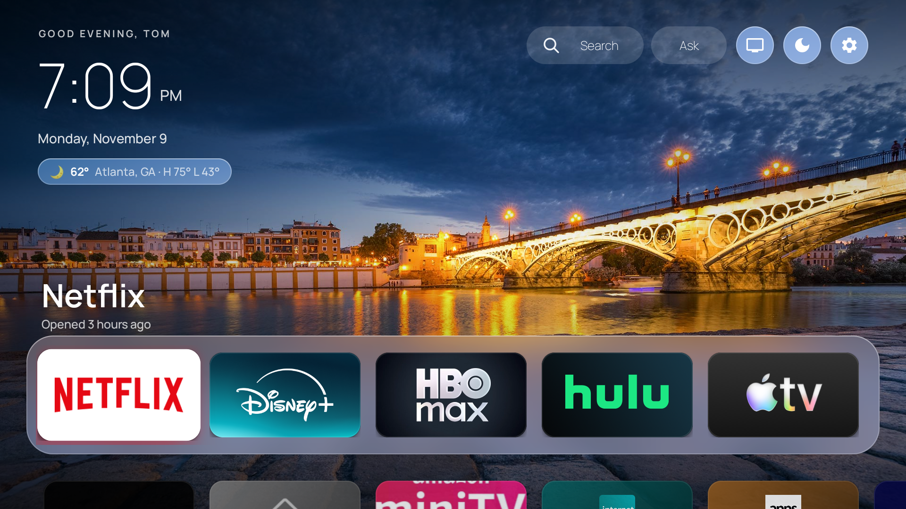
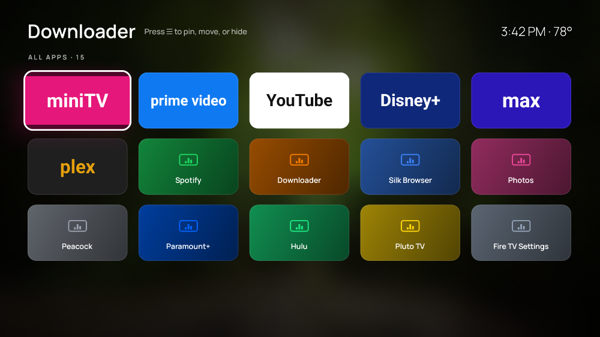
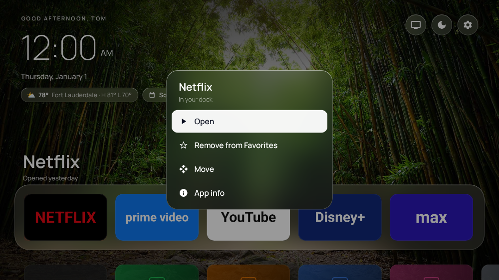

<div align="center">

# AttuneTV

### Your TV. Beautifully yours.

A cinematic, ad-free home screen for Fire TV.<br>Your favorite apps. A fresh view every day. Everything within reach.

[](https://github.com/thellis954/attunetv/actions/workflows/build.yml)   

**[Get started](docs/install.md)** · **[Download APK](https://github.com/thellis954/attunetv/releases/latest/download/AttuneTV.apk)** · **[Build & contribute](CONTRIBUTING.md)** · **[Report a bug](https://github.com/thellis954/attunetv/issues/new)**



<sub>Actual Fire TV screenshot, captured on an Insignia TV running AttuneTV 0.4.1. Streaming apps are installed separately.</sub>

</div>

## Make room for what you love

Turn on your TV and land somewhere that feels like home. A beautiful daily photograph. A quiet clock. The apps you chose, exactly where you put them.

AttuneTV replaces the Fire TV home experience with a fast, remote-friendly launcher. No sponsored rows or autoplaying trailers on your home screen. No rooting. Your streaming apps, subscriptions and Amazon settings stay in place.

| A better way to… | What you get |
| --- | --- |
| **Settle in** | Daily photo backgrounds, frosted glass, a large clock and a personal greeting. Choose a photo, app-color glow or one of five dark themes. |
| **Find something to watch** | A visible **Search** button for installed apps and a shortcut to Fire TV's movie and show search. |
| **Keep your favorites close** | A dock of real app artwork. Pin, reorder and hide apps with the remote. Press **Down** for all apps. |
| **Make it personal** | Weather, your next calendar event, 12/24-hour time and a photo ambient mode. |
| **Skip the remote typing** | Scan a QR code to customize your home screen from your phone on the same Wi-Fi. |
| **Explore what's next** | **Ask with AttuneTV**, a native ChatGPT companion in early preview. [See its current status ↓](#meet-ask-with-attunetv) |

<table>
<tr>
<td width="50%"><br><strong>Your whole app library.</strong> One press down from the dock.</td>
<td width="50%"><br><strong>Your layout, your call.</strong> Organize from the couch.</td>
</tr>
</table>

<sub>These two images are layout test renders with placeholder app art. The large screenshot above is from a real TV.</sub>

## Get it on your TV

**You don't need to be a developer.** You need a compatible Fire TV, its remote and a Mac, Windows or Linux computer for the one-time installation. After setup, the launcher runs on the TV; the computer can be shut down.

1. **[Download AttuneTV.apk](https://github.com/thellis954/attunetv/releases/latest/download/AttuneTV.apk).** No GitHub account, source-code download or build tools required. [Release notes & checksums](https://github.com/thellis954/attunetv/releases/latest).
2. **Connect to your TV.** Put the computer and TV on the same Wi-Fi, enable ADB debugging and approve the connection with your remote.
3. **Install and make it Home.** Follow the copy-and-paste steps, then personalize it with your phone.

### [Start the step-by-step installation →](docs/install.md)

The guide includes **Mac, Windows and Linux instructions**, expected results, updates, troubleshooting and how to go back. No Android Studio or coding required to install a prebuilt APK.

> **Early preview:** the launcher has been tested on an Insignia NS65-UQFL26 with Fire OS 8.1.6.4. Other Android-based Fire TVs are unverified. The APK is sideloaded; there is no app-store or one-click installer yet. Official releases share a consistent signing key for updates. Earlier development builds may need special handling. [Compatibility & update details](docs/install.md#before-you-start).

## Meet Ask with AttuneTV

**The idea: a conversation beside what you're watching.** Ask about a character, untangle a plot point or explore the story behind a film, right on your TV.

The native preview puts the chat panel, remote input and account connection on the television. Model requests go directly to OpenAI. There is no companion Mac, personal server or developer API key to set up. Chat is optional; the home screen works without a ChatGPT account.

**Try the preview:** open **Ask → Continue with ChatGPT** and sign in through the browser on the **TV**. An eligible account and OpenAI consent are required; plan limits apply. The setup screen also offers a panel preview.

**Where it stands today:** the native build is installed on the test TV and the OpenAI sign-in page opens in Silk. Successful account connection, a real model response and playback compatibility are still awaiting end-to-end verification. Streaming-app chat is therefore **hidden in the current normal build**.

Prime Video, Netflix, Apple TV, Disney+, Hulu, HBO Max, Peacock and Paramount+ are **integration targets, not a confirmed support list**. Each must pass playback, remote-input and dismissal checks before its overlay is enabled.

The assistant does not watch or listen to your video. You can supply a title, episode or scene description; automatic playback information depends on what the app and device expose. Answers can be wrong or contain spoilers.

[Read the native architecture and verification checklist →](docs/standalone-chat.md)

## Samsung TV companion — hosted preview

**Keep watching on the TV. Keep the conversation on your phone.** A separate
Tizen preview adds full-screen TV chat, QR-paired phone chat and a shared
conversation with movie, episode and progress context you supply.

Its phone setup walks you through getting your own **OpenAI, Claude, Grok or Kimi
API key**, reviewing provider billing, checking access and choosing a model.
API usage is billed by your provider; it is not automatically included in a
consumer chat subscription. The companion uses a hosted service so the phone
can keep chatting while Samsung suspends the TV app. Viewers do not need an
always-on Mac.

**[Try the hosted preview](https://attunetv-samsung.vercel.app/tv)** — pair your
phone and follow the guided API-key setup. Hosting runs on Vercel with persistent
Neon storage. Deployed pairing and cross-screen context sync are verified;
Samsung hardware installation and real provider calls are still pending. This is not the Fire TV APK, and it cannot overlay Samsung’s
built-in streaming apps. [Samsung preview, setup and deployment guide](samsung/README.md).

## Learn the remote in a minute

| On AttuneTV Home | Action |
| --- | --- |
| **Left / Right** | Browse favorites. |
| **Down** | Open all apps. |
| **Up** from the dock | Reach Search, Ask and the round shortcuts. |
| **OK** | Open the focused app or action. |
| **Menu ☰** or **hold OK** on an app | Open, pin/unpin, move, hide or view app info. |
| **Back** | Close a menu or return from the app grid. |
| **Home** | Return to AttuneTV when Home redirection is enabled. |

The round shortcuts open **Inputs**, **Ambient mode** and **Settings**. In move mode, use the arrows to position an app and press OK to finish.

## Built for people who like to build

Native Kotlin. One Android app module. Real TV layouts you can render in tests. No backend to operate.

The interesting work lives in small, focused pieces: remote navigation, CPU-blurred glass that works on Android 11, a narrowly scoped Home redirect, and native account-backed chat. Bring your device, your taste or your debugging skills.

```bash
git clone --branch claude/blissful-hypatia-4dfwls https://github.com/thellis954/attunetv.git
cd attunetv
# Configure JDK 17 and Android SDK 35 first; see the contributor guide.
./gradlew assembleRelease testDebugUnitTest
```

**[Developer setup & contribution guide →](CONTRIBUTING.md)**

Useful contributions include device compatibility reports, remote-focus polish, accessibility improvements, better app artwork fallbacks and verified streaming integrations. For a new integration, real playback evidence matters as much as a passing build.

## A few things worth knowing

<details>
<summary><strong>Does this remove Amazon's launcher or change my subscriptions?</strong></summary>

No. An accessibility service notices Amazon's Home screen and brings AttuneTV forward. Amazon packages stay installed. You may briefly see Amazon Home during the handoff. Streaming apps keep their own accounts, subscriptions, ads and playback behavior.

</details>

<details>
<summary><strong>Do I need an always-on computer, a phone or a ChatGPT account?</strong></summary>

A computer is used for installation and updates, not everyday launcher operation. A phone is optional for personalization. ChatGPT is optional for the chat preview, which is implemented on the TV and still undergoing end-to-end validation. Internet access is needed for online features such as fresh photos, weather and chat.

</details>

<details>
<summary><strong>How does search work?</strong></summary>

Installed-app search is local. Movie and show search opens Amazon's Fire TV catalogue search, where results and streaming availability are supplied by Amazon. It is not an independent universal streaming catalogue. Amazon's launcher must remain installed.

</details>

<details>
<summary><strong>What information does the app access?</strong></summary>

Home redirection does not read screen content. Optional chat uses your question and supplied context; it does not capture video, audio or subtitles. Chat credentials are encrypted on the TV. Phone setup is a temporary, PIN-protected local HTTP page; use it on trusted Wi-Fi. Weather, photos and calendar feeds contact their respective providers. [More about chat and playback metadata](docs/standalone-chat.md).

</details>

<details>
<summary><strong>Can I go back to the original home screen?</strong></summary>

Yes. In AttuneTV Settings, turn **Redirect Home button** off. The installation guide also explains how to remove only AttuneTV's accessibility entry and uninstall the app while preserving other services.

</details>

---

**Make your TV feel like yours.** [Get started](docs/install.md), [share a device report](https://github.com/thellis954/attunetv/issues/new), or star the repo to help others discover it.

Built by [Tom Ellis](https://github.com/thellis954). AttuneTV is an independent project, not an official Amazon, OpenAI or streaming-service app. Product names and logos belong to their respective owners.
