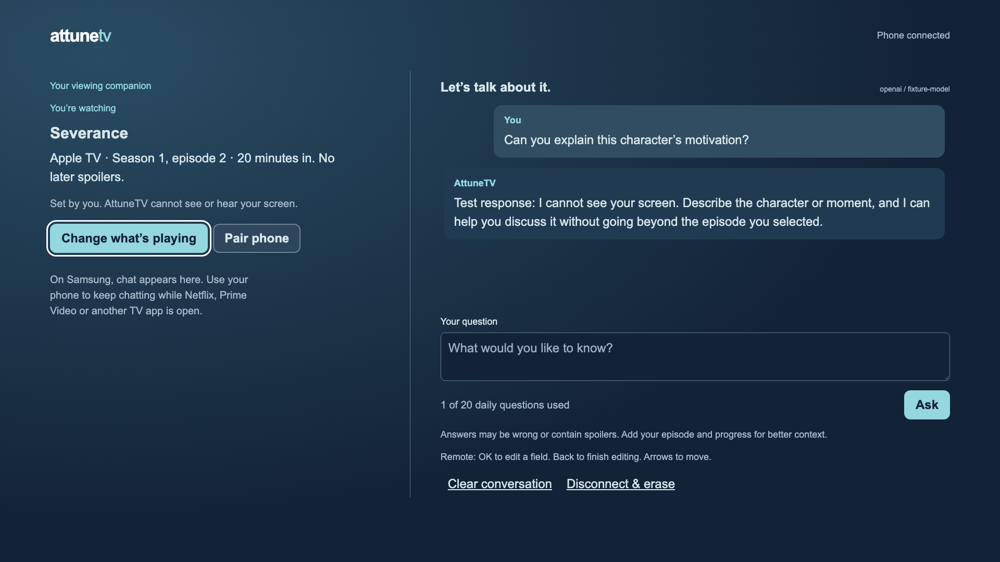
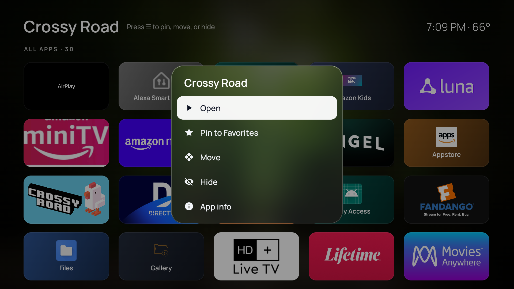

<div align="center">

# AttuneTV

### Turn your phone into an AI companion for what you’re watching.

**The show on your TV. The conversation in your hand.**

Scan a QR code, connect your choice of AI, and ask from your phone while you watch.<br>Characters, plot twists, real history, filmmaking—follow your curiosity without covering the big screen.

**[Start with your phone](docs/ai-setup.md)** · **[Set up your TV](docs/setup.md)** · **[Build with us](CONTRIBUTING.md)**

Samsung Tizen · Fire TV · Web + phone · Android TV / Google TV experimental

[](https://github.com/thellis954/attunetv/actions/workflows/build.yml) [](https://github.com/thellis954/attunetv/actions/workflows/samsung.yml) [](https://github.com/thellis954/attunetv/releases/latest) 

<table>
<tr>
<td width="30%" align="center" valign="top"><a href="docs/images/companion-phone.png"></a><br><strong>Your companion, in your hand.</strong></td>
<td width="70%" align="center" valign="top"><a href="docs/images/companion-tv.png"></a><br><strong>One conversation, shared with your TV.</strong><br>Pair here. Return to your show. Keep asking on your phone.</td>
</tr>
</table>

*Actual phone and TV companion interfaces from browser tests. Answers and dictation use fixtures; these are not live AI answers or Samsung-device captures. [Screenshot details](docs/images/README.md).*

</div>

**Give the phone beside you a part in movie night.** When a character makes a strange choice or a true story leaves you wanting to know more, pick up your phone and ask. AttuneTV keeps the title, episode, progress and conversation together, using the context you supply. Your TV keeps playing; your phone becomes the place to explore.

**Free to download. Your choice of AI. No always-on computer.** Bring a provider API key for answers; API usage is billed separately. AttuneTV is an early preview, with [different experiences on each platform](#get-it-on-your-screen).

## Meet Ask with AttuneTV

### Scan. Pair. Make it your companion.

Open AttuneTV on your TV—or open the [hosted preview](https://attunetv-samsung.vercel.app/tv) on a computer to try it. Your phone connects in its browser; there is no separate phone app to install.

1. **Pair.** Open **Pair phone**, scan the QR code and approve the matching number on the TV companion.
2. **Connect.** Follow the phone’s guided provider setup and enter your API key privately.
3. **Watch and ask.** Add the title, episode and progress, return to your streaming app, and ask from your phone. Type or use phone dictation where supported. Follow-up questions stay in the same conversation.

**The phone is part of the experience from the first question.** It gives you a comfortable keyboard, a place for longer answers and room to explore without putting chat over the movie. Reopen AttuneTV on the TV when you want to bring that conversation back to the big screen.

On Samsung, the companion is a full-screen app; the phone is where you chat while Netflix, Prime Video or another built-in app plays. Fire TV streaming overlays are still in development and hidden in normal builds.

**[Try it in your browser →](https://attunetv-samsung.vercel.app/tv)** · **[Pairing and AI setup →](docs/ai-setup.md)**


### From “what just happened?” to “tell me more.”

Ask a question, then follow it wherever your curiosity leads. The conversation keeps your supplied viewing context and earlier messages together, so the next question can build on the last.

| Your curiosity | Start a conversation |
| --- | --- |
| **Characters and connections** | “How are these two characters connected? I’m halfway through episode two.” |
| **History behind the story** | “Which parts of this historical setting are based on real events?” |
| **The craft of filmmaking** | “Why might the director keep using mirrors in this scene?” |
| **More to explore** | “What other films explore this theme? Tell me what makes them similar.” |

Choose **OpenAI, Claude, Grok or Kimi** in guided phone setup. Follow the account and API-key links, check your key, choose a model, and set a daily question limit. Your provider and model stay your choice.

**Tell it where you are in the story.** Enter the title, episode, progress and any detail the question needs. AttuneTV does not watch the video, listen to its audio or read its subtitles. Context helps guide answers; it does not guarantee accuracy or prevent every spoiler.

## Less clutter. More cinema.

**Room to breathe is part of the experience.** Deep colors, generous spacing, readable type and clear focus states keep the companion easy to follow from the couch. On the phone, a familiar conversation layout puts your question within reach.

On Fire TV, that design extends all the way to Home: edge-to-edge photography, a thin oversized clock, translucent glass panels and a favorites dock built around your apps. No promotional feed on the AttuneTV home screen. Just a place that feels like yours.


*Real Insignia capture · 0.5.0 development build, before later glass/font refinements. The launcher is the Fire TV experience; Samsung uses the companion UI above. Streaming apps are installed separately.*

<table>
<tr>
<td width="50%"><a href="docs/images/apps-fire-tv.png"></a><br><strong>Your apps, beautifully organized.</strong><br>Open the grid with one press. Pin, move or hide.</td>
<td width="50%"><a href="docs/images/menu-fire-tv.png"></a><br><strong>Made for the remote.</strong><br>Clear selection, readable labels and simple actions.</td>
</tr>
</table>

*Real Insignia grid and menu captures from 0.3.3; earlier artwork and styling. [All screenshot versions](docs/images/README.md).*

The Fire TV launcher also includes **app search and a shortcut to Amazon’s movie/show search**, daily photography, ambient mode, a personal greeting, optional weather and calendar information. Scan a separate setup QR code to personalize Home from your phone. It works independently of AI.

## Why AttuneTV?

**Your phone becomes part of watching.** AttuneTV brings pairing, viewing context, AI choice and conversation continuity into one companion. The show stays on the TV; the questions, discoveries and follow-ups stay close at hand.

- **Watch on TV. Explore on your phone.** Keep chatting while your streaming app is open, without an overlay covering the show.
- **Keep the thread.** Your supplied title, episode, progress and earlier questions stay together in a shared conversation.
- **Choose your AI.** Pick a provider and model through guided phone setup.
- **Make the interface yours.** A spacious companion across TV and phone, plus a personal cinematic Home on Fire TV.

[The product direction and competitive landscape →](docs/positioning.md)

## Get it on your screen

**Start with your TV’s platform. Each path has its own step-by-step guide.** No coding is needed to try the hosted companion or follow the Fire TV APK guide. Samsung currently needs a computer, Developer Mode and a signed developer package.

| Your screen | Your experience | Get started |
| --- | --- | --- |
| **Samsung Tizen** | Full-screen viewing companion + paired phone chat during playback. Does not replace Smart Hub. | **[Samsung setup](docs/samsung-install.md)** |
| **Fire TV / Android-based Fire TV Stick** | Cinematic Home, app organization and search. Shared AI companion in the 0.5.0 development build. | **[Fire TV setup](docs/install.md)** |
| **Web + phone** | Explore the shared companion before installing a TV app. Open the TV page on a computer, then pair your phone. | **[Open preview](https://attunetv-samsung.vercel.app/tv) · [Connect AI](docs/ai-setup.md)** |
| **Android TV / Google TV** | Experimental APK path; physical-device compatibility still needs testing. | **[Testing guide](docs/android-tv-install.md)** |

After native installation, you can shut down the setup computer. The launcher runs on the TV; the companion uses the hosted service.

**Which download?** The [public Fire TV APK is 0.4.2](https://github.com/thellis954/attunetv/releases/latest), which predates shared API-key chat. That flow is available in **0.5.0 development source**, the **Samsung 0.1.0 preview** and the **hosted companion**. Follow [release and compatibility guidance](docs/setup.md) to pick the right path.

Roku, Apple TV hardware, LG webOS and non-Android Fire TV do not yet have native packages. You can explore the separate browser/phone companion regardless of what you watch, with context entered manually; this does not add a launcher or overlay to those TVs.

<details>
<summary><strong>What works today—and what is still being verified?</strong></summary>

<a id="what-works-today"></a>

- **Fire TV Home:** tested on Insignia NS65-UQFL26 / Fire OS 8.1.6.4. Other devices need individual checks.
- **Samsung:** 0.1.0 installed and running on QN65Q65FN / Tizen 4.0. Actual-TV pairing-link and QR generation verified after the origin fix. Real phone approval, live answers and return-to-app behavior still need acceptance. [Device evidence](docs/device-checks/samsung-qn65q65fn.md).
- **Shared chat:** pairing, context, session isolation and conversation flows have automated coverage. Test responses establish behavior, not live model quality; real provider/device acceptance remains open.
- **Streaming overlays:** hidden in normal Fire TV builds until per-app playback, focus and dismissal checks pass. Samsung has no overlay over built-in streaming apps.

Prime Video, Netflix, Apple TV, Disney+, Hulu, HBO Max, Peacock and Paramount+ are Fire TV integration targets, not a verified overlay support list. Opening an installed app is separate from integrating with its player.

</details>

## Build the next version with us

There is room here for people who care about **AI, thoughtful interfaces and making existing TVs more useful**. Improve a pairing flow, refine remote focus, test your TV, or help validate an integration.

| Work on | Start here |
| --- | --- |
| **Companion, phone UI and AI providers** | [Web/service development](samsung/README.md) · Node 24, Python 3, ES5-compatible TV client |
| **Native Home and Fire TV chat** | [Android contributor guide](CONTRIBUTING.md) · Kotlin, JDK 17, Android SDK 35 |
| **Architecture and playback integration** | [Shared chat architecture](docs/standalone-chat.md) · [Device verification](docs/standalone-chat.md#verification) |
| **Compatibility and design feedback** | [Report your model or an issue](https://github.com/thellis954/attunetv/issues/new) · Include version and screenshots, without keys or pairing codes |

```bash
git clone --branch claude/blissful-hypatia-4dfwls https://github.com/thellis954/attunetv.git
cd attunetv
```

The hosted service runs on **Vercel with Neon Postgres**. Automated companion tests use fixture responses, so contributing does not require buying AI credits. The source is public; a redistribution license has not yet been declared.

**[Contributor guide](CONTRIBUTING.md)** · **[Service development](samsung/README.md)** · **[Release process](docs/releasing.md)**

## Before you settle in

<details>
<summary><strong>Is this free? Can I use my ChatGPT subscription?</strong></summary>

The launcher is free to download and works without AI. The companion uses your own provider API key; API billing is separate from consumer chat subscriptions. Its daily question limit is not a dollar spending cap. Set provider-side budgets where available. Self-hosting can also incur hosting costs.

</details>

<details>
<summary><strong>Does it remove Amazon apps or block ads in streaming services?</strong></summary>

No. Home redirection brings AttuneTV forward when Amazon Home opens; Amazon packages remain installed. A brief Home handoff can be visible. Ad-free refers to AttuneTV’s home screen, not ads within other apps. Turn Redirect Home button off in Settings to go back, or follow the [uninstall guide](docs/install.md#go-back-or-uninstall).

</details>

<details>
<summary><strong>What about privacy?</strong></summary>

The Home service does not read screen content. Chat sends your questions and supplied context to your chosen provider through the hosted service. Provider keys and stored conversations are encrypted at rest; this is not end-to-end encryption from the service operator. Use Disconnect & erase to remove the room, key and sessions from the service. Provider retention policies apply separately.

Optional phone dictation uses the browser’s speech service. The separate launcher-settings page is temporary, PIN-protected local HTTP; use trusted Wi-Fi. Photos, weather and calendar feeds contact their respective providers. Never include keys, pairing credentials or private calendar URLs in bug reports.

</details>

<details>
<summary><strong>Is it open source?</strong></summary>

The code is public and contributions are welcome, but the repository currently has no declared license. Ask the maintainer before redistributing it or incorporating the code into another product.

</details>


---

**Your show. Your questions. Your companion.** [Pair your phone](docs/ai-setup.md), [set up your screen](docs/setup.md), or [help build it](CONTRIBUTING.md). Star the repo to help more people discover it.

Built by [Tom Ellis](https://github.com/thellis954). Independent project; not an official Amazon, Samsung, OpenAI or streaming-service app. Product names and logos belong to their respective owners.
