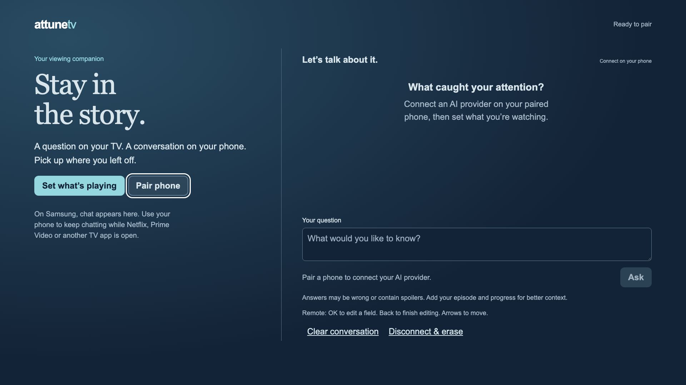

# AttuneTV for Samsung — developer preview

A conversation on your TV and phone, about what you choose to watch.

**[Open the hosted preview](https://attunetv-samsung.vercel.app/tv)** on a computer
or TV browser, then choose **Pair phone**. The phone walks you through obtaining
and connecting your own API key. The packaged Samsung app still requires signing
and installation.



This is a separate **Tizen companion**, alongside the existing Fire TV launcher.
Samsung does not support placing a normal third-party app over another app.
Open AttuneTV for full-screen TV chat; use the paired phone while Netflix,
Prime Video or another built-in app plays. Returning to AttuneTV loads the same
conversation. It does not replace Smart Hub, launch or modify streaming apps,
capture playback, or automatically identify a scene.

## What is built

- TV interface with remote focus, editable title/episode/progress and transcript.
- QR pairing with a five-minute link and matching-number approval on the TV.
- Phone conversation independent of the TV app’s lifetime.
- Guided **bring your own API key** setup for OpenAI, Claude, Grok and Kimi:
  provider billing and key-page links, key check, available model selection,
  explicit billing consent, and a daily request limit.
- Server-encrypted API keys and transcripts, isolated rooms, cancellation,
  duplicate-request protection, disconnect/erase and key removal.
- Unsigned `.wgt` build tooling, container deployment files and automated tests.

**Verification boundary:** automated service tests and desktop-browser tests use
fixture credentials and responses. These verify request contracts and UI behavior,
not paid inference, every provider/model combination, or Samsung hardware behavior.
The deployed Vercel/Neon service has also passed real HTTPS pairing, setup-link and cross-screen context checks without a live API key. The physical QN65Q65FN reports Tizen and Developer Mode off. No app has been
installed on it yet. The review package is unsigned; rebuild with the hosted HTTPS origin before signing.

## For viewers: connecting AI

Once an operator has installed the Samsung app and deployed its companion service:

1. Open AttuneTV on the TV and select **Pair phone**.
2. Scan its QR code, tap **Pair this phone**, and approve the matching number on TV.
3. On your phone, choose **AI connection** and your provider.
4. Use the in-app links to create a developer account, review pricing, add API
   credit if required and set the provider’s available spending controls.
5. Create an API key named **AttuneTV** with model-list and text-generation access.
   Copy it and return to the phone setup. Do not send it in chat, email or screenshots.
6. Paste it into the password field, tap **Check key & load models**, and choose a
   text model. This check lists models; it does not generate an answer. It cannot
   guarantee that every listed model supports this app’s request format.
7. Set a daily question limit and acknowledge provider billing. Tap **Connect provider**.
8. Enter the movie/show, episode and progress. Ask on either screen. To keep
   watching through a Samsung streaming app, leave AttuneTV and use your phone.

AttuneTV is free to download. **API usage and service hosting can cost
money.** A consumer chat subscription does not automatically authorize these API
requests. The daily question limit (default 20, up to 100) is not a dollar budget;
provider-side controls are separate. Requests have a 1,200-output-token maximum
and bounded conversation history. Requests that fail or are stopped may be billed.
No request is automatically retried or silently moved to another model/provider.

The API-key flow replaces the earlier proposed hosted ChatGPT-account flow for
this Samsung version. It does not wait for a hosted Sign in with ChatGPT approval.
It does not collect consumer-login passwords, cookies or OAuth tokens.

## Development

Node 24 and Python 3 are required. From `samsung/`:

```sh
npm ci
npm test
npm run check
npx playwright install chromium
npm run test:browser
ATTUNE_LOCAL_DEV=1 npm start
```

Open `http://127.0.0.1:8787/tv` locally. Browser tests start a separate **test-only**
provider and pair independent TV/phone contexts, close the TV page, ask on the
phone and verify sync when the TV returns. Test answers are visibly labeled.
Production `npm start` never enables a fake provider.

Loopback development is not a phone-accessible deployment. Do not expose that
HTTP mode or tunnel it for real API keys. Use HTTPS for real phones and TVs.
The client uses ES5 syntax, flexbox, XHR and no third-party scripts, fonts or QR
services. That targets Tizen 4’s Chromium 56 but does not replace on-device tests.

## Deploy once; users do not need an always-on computer

The service must run on an always-available host because Samsung suspends the TV
app when a streaming app opens. This is infrastructure operated for the app;
viewers do not need a Mac or their own server. The hosted preview deployment is tracked separately from physical Samsung installation.

The primary hosted target is **Vercel with Neon Postgres through Vercel Marketplace**.
The serverless entry point is `server.mjs`; Vercel project root is `samsung`,
Node 24, framework Express, build command `npm run build:vercel`.

1. Import this repository and select its active branch, with `samsung` as root.
2. In Vercel Storage, create a Neon database in the same region as the function
   (this pilot uses Washington, D.C. / `iad1`). Connect it to Production so
   `DATABASE_URL` is injected automatically. Start with the Free plan if suitable.
3. Add `ATTUNE_ENCRYPTION_KEY` as a **sensitive production environment variable**:
   a cryptographically random 32-byte key encoded as 64 hexadecimal characters.
   Keep it stable across deployments; losing it makes existing data unreadable.
   Never place it in frontend config, logs or Git.
4. Add `PUBLIC_ORIGIN` as the exact production HTTPS origin without a trailing
   slash. It controls pairing links and origin checks. Add a random `CRON_SECRET`
   for daily retention cleanup. Do not share production secrets with previews.
5. Deploy, check `/health`, and verify QR pairing on `/tv` and `/phone` before
   building the TV package with that same service origin.

Vercel and Neon are subject to their current plan limits. The private pilot uses
Neon's Free plan; this is not a promise of unlimited free hosting. Provider API
charges are separate. Review Vercel's plan suitability before a commercial launch.
Preview deployments intentionally lack production encryption secrets and cannot
read production conversations. Configure an isolated preview database and key if
live preview testing is required.

Production uses pooled Postgres connections, encrypted keys/transcripts,
transactional pairing/limits/idempotency, and persisted cancellation/deadlines.
Provider calls run with Vercel `waitUntil`, bounded to 90 seconds inside a
120-second function. An interrupted invocation becomes a visible error after
its deadline; it is never automatically billed again by a retry. Requests can
land on separate instances. The private preview serializes short state changes
with a database lock; provider calls run outside transactions. This design needs
load testing before broad public rollout.

Local development and the optional Docker Compose stack retain SQLite. These
require persistent storage and a single process; **do not use local SQLite or
`/tmp` for Vercel persistence**. Production uses Postgres exclusively. Run the
additional real-Postgres integration test with `TEST_DATABASE_URL` pointing to a
disposable test database. CI supplies one automatically. The test verifies two
independent instances, concurrent one-use pairing and retries, shared daily
limits, cancellation, rollback, expiry and erase.

Do not enable `ATTUNE_LOCAL_DEV` publicly. Redact Authorization/Cookie headers
and request bodies on every `/api` route if adding observability. The service
avoids logging credentials, prompts and provider error bodies. Back up the
database and encryption key securely with a documented retention policy.

The private pilot has a 1,000-room capacity, shared request limits, one phone per
TV and 30-day session/retention bounds. Public launch still needs operational
backups, abuse testing, privacy/support policy and real device/provider checks.

## Build and install on a Samsung TV

After deploying HTTPS:

```sh
ATTUNE_SERVICE_ORIGIN=https://your-owned-hostname.example npm run build
```

This produces `dist/tizen/`, `dist/AttuneTV-Samsung-0.1.0-UNSIGNED.wgt`, checksums and
a build-status file. A build without `ATTUNE_SERVICE_ORIGIN` is an **offline shell
for inspection**, not an installable connected product. It honestly displays
“Service setup needed”.

Use Samsung Tizen Studio with its TV and certificate extensions:

1. On the TV’s Apps screen, enter **12345** using the remote’s number keypad.
   Turn Developer Mode on, enter the installer computer’s LAN IP, then restart
   when convenient. This is a user step; do not interrupt playback automatically.
2. Connect the TV in Tizen Device Manager (`192.168.86.55` is Tom’s current test TV).
3. Create a **Samsung TV** certificate profile using your Samsung account and the
   connected device’s DUID. Keep keys/passwords outside Git. Permit installation
   for that device. Do not share a distributor certificate between unrelated TVs.
4. Build/sign the `dist/tizen` web project with that certificate profile and install
   the resulting signed `.wgt` through Tizen Studio. A ZIP renamed `.wgt` is not a
   signed Samsung installation package.
5. Open AttuneTV, pair a phone, connect a real provider key, and verify the checklist
   below before calling this TV supported.

See Samsung’s [device setup](https://developer.samsung.com/smarttv/develop/getting-started/using-sdk/tv-device.html)
and [certificate guide](https://developer.samsung.com/smarttv/develop/tools/additional-tools/vscode/creating-certificates.html).

## Acceptance checklist

- QR scan and matching-number approval on the physical TV; expired/replaced link rejected.
- Guided provider setup from an actual phone; real question and answer, billing verified.
- Shut down/disconnect the installer Mac: phone chat and TV chat still work.
- Leave AttuneTV for each streaming app; playback continues and phone chat works.
- Return to AttuneTV: title, episode and conversation resynchronize without duplicates.
- Remote OK/IME/Back, D-pad focus, transcript scrolling and text entry on Tizen 4.
- No clipped text at the TV’s actual resolution; legible focus ring and QR from the couch.
- Restart service and TV; paired state persists, interrupted answer becomes an error.
- Clear, disconnect, API-key removal, provider failures and daily-limit behavior.
- Share screenshots/report labeled **real device** or **browser fixtures**, never interchangeably.

## Privacy and limitations

Questions and your manual viewing context are sent to the selected AI provider.
No video frames, audio, subtitles, Samsung credentials or streaming credentials
are accessed. The paired TV may spend against the phone owner’s key until it is
removed or pairing expires. Pair only with trusted people/devices.

This is **server-side encryption, not end-to-end encryption**: the service
operator can decrypt keys to make requests. The key never appears in the TV
payload or client storage. Phone setup holds it temporarily in a password field,
clears it when setup closes, and uses a Secure/HttpOnly/SameSite cookie in HTTPS.
TV bearer credentials are stored on the TV. Disconnect deletes active records;
operators must separately manage backup retention. Keys must be revoked in the
provider console to stop their use outside this service.

Voice entry can use a phone keyboard’s own dictation where available. There is
no in-app microphone capture, TV voice integration, or automatic scene recognition.
Answers and spoiler avoidance are not guaranteed.

### Hosted smoke check

```sh
ATTUNE_VERIFY_ORIGIN=https://attunetv-samsung.vercel.app node scripts/verify-hosted.mjs
```

This creates and erases a temporary test pairing, checks the provider setup links
and cross-screen manual context, and saves hosted-browser screenshots. It never
submits an API key or makes a paid inference request.
